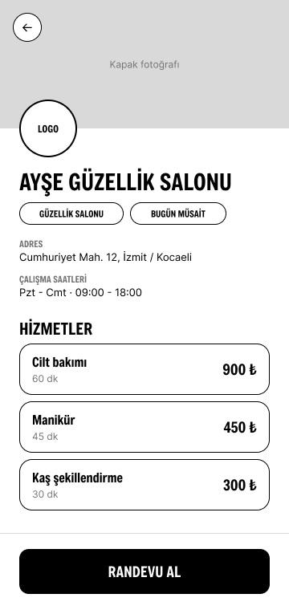

# Slotly

Çok kiracılı (multi-tenant) randevu ve işletme yönetim platformu (SaaS).

> 🚧 Geliştirme aşamasında.

## Tasarım

Düşük doğruluklu (low-fidelity) wireframe'ler: [Figma'da görüntüle](https://www.figma.com/design/uWSfkeqmrJwdxFRprNdODL/Slotly-Wireframes?node-id=0-1)

| Müşteri tarafı | İşletme paneli |
|---|---|
|  |  |
|  |  |

Tüm ekranlar (giriş/kayıt, randevu sihirbazı, takvim, hizmetler, çalışanlar, müşteriler, ayarlar, ortak durum şablonları) `docs/wireframes/` klasöründe ve Figma dosyasında.

## Geliştirme ortamı

| Araç | Sürüm |
|---|---|
| .NET SDK | 10.0.401 |
| Node.js | v26.13.1 |
| npm | 11.20.0 |
| Docker | 29.9.3 |
| Docker Compose | 5.7.0 |
| Git | 2.55.0.windows.1 |
