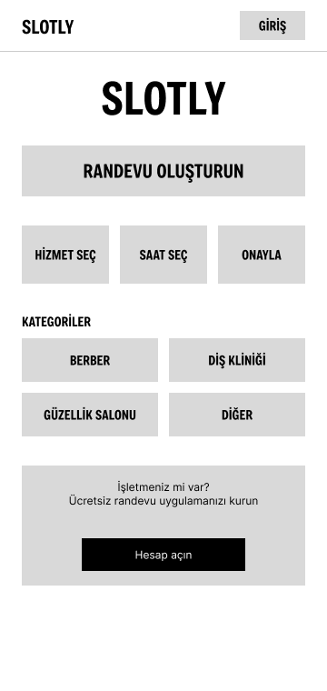
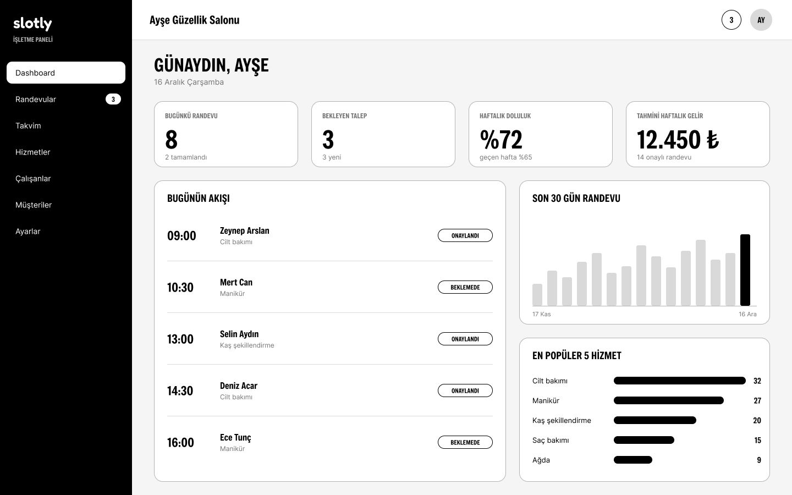
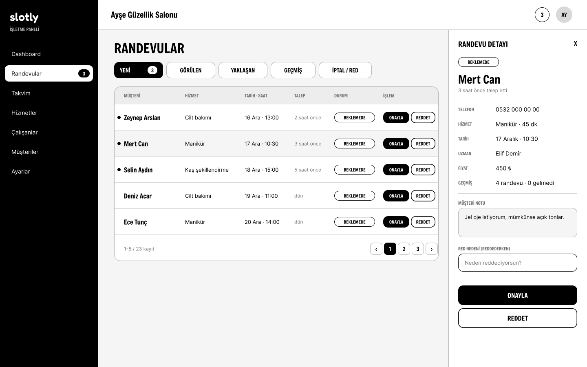

# Slotly

Çok kiracılı (multi-tenant) randevu ve işletme yönetim platformu (SaaS).

> 🚧 Geliştirme aşamasında: 10 haftalık uçtan uca bootcamp projesi.

## Vizyon

Berber, güzellik salonu, diş kliniği, psikolog gibi randevuyla çalışan küçük işletmeler, kendi randevu sayfalarını dakikalar içinde kurar ve yönetir. Müşteri işletmenin sayfasından boş saati görüp randevu alır, işletme sahibi talepleri panelinden onaylar.

Projenin odağı: tek kod tabanı ile çok işletmeye hizmet (multi-tenancy), çifte rezervasyonun engellenmesi ve güvenilir bildirimler.

## Özellikler

Planlanan özellikler (tamamlandıkça işaretlenecek):

**Müşteri**
- [ ] İşletme vitrin sayfası ve hizmet listesi
- [ ] 5 adımlı randevu sihirbazı (hizmet, uzman, tarih, saat, onay)
- [ ] Randevularım: yaklaşan/geçmiş, iptal, yeniden planlama
- [ ] E-posta onayı ve hatırlatma

**İşletme sahibi**
- [ ] Ayrı girişli yönetim paneli
- [ ] Randevu talepleri: Yeni, Görülen, Yaklaşan, Geçmiş, İptal sekmeleri
- [ ] Takvim, hizmet, çalışan ve çalışma saati yönetimi
- [ ] Anlık bildirim (yeni talep geldiğinde)
- [ ] Dashboard ve istatistikler

**Platform**
- [ ] Çok kiracılı veri izolasyonu
- [ ] Arka plan işleri ve sistem sağlığı paneli

## Teknoloji yığını

| Katman | Teknoloji |
|---|---|
| Backend | ASP.NET Core Web API (.NET 10), Clean Architecture |
| ORM | Entity Framework Core (Code-First) |
| Veritabanı | SQL Server 2022 (Docker) |
| Kimlik | ASP.NET Core Identity + JWT (refresh token rotation) |
| Frontend | Next.js (App Router) + TypeScript |
| Arayüz | Tailwind CSS + shadcn/ui |
| Gerçek zamanlı | SignalR |
| Arka plan işleri | Hangfire |
| E-posta | MailKit (yerelde Mailpit) |
| Test | xUnit, Testcontainers, Playwright |
| CI/CD | GitHub Actions + Docker |

## Proje yapısı

```text
slotly/
├── backend/               # ASP.NET Core API (Hafta 2'den itibaren)
├── frontend/              # Next.js uygulaması (Hafta 6'dan itibaren)
├── docs/
│   ├── user-stories.md    # Kullanıcı hikâyeleri ve MoSCoW öncelikleri
│   ├── erd.dbml / erd.png # Veritabanı şeması
│   ├── appointment-states.md  # Randevu durum makinesi
│   └── wireframes/        # Ekran taslakları (PNG)
├── docker-compose.yml     # SQL Server 2022
├── .env.example           # Ortam değişkenleri şablonu
└── README.md
```

## Nasıl çalıştırılır

> Uygulama kodu henüz yok; bu bölüm haftalar ilerledikçe tamamlanacak.

**Veritabanı (şu an çalışıyor):**

```bash
cp .env.example .env     # .env içindeki parolayı kendine göre değiştir
docker compose up -d
docker compose ps        # STATUS: healthy olana kadar bekle
```

Backend ve frontend adımları Hafta 2 ve Hafta 6'da eklenecek.

## Dokümantasyon

- [Kullanıcı hikâyeleri](docs/user-stories.md)
- [Veritabanı şeması (DBML)](docs/erd.dbml)
- [Randevu durum makinesi](docs/appointment-states.md)

## Tasarım

Düşük doğruluklu (low-fidelity) wireframe'ler: [Figma'da görüntüle](https://www.figma.com/design/uWSfkeqmrJwdxFRprNdODL/Slotly-Wireframes?node-id=0-1)

| Müşteri tarafı | İşletme paneli |
|---|---|
|  |  |
|  |  |

Tüm ekranlar (giriş/kayıt, randevu sihirbazı, takvim, hizmetler, çalışanlar, müşteriler, ayarlar, ortak durum şablonları) `docs/wireframes/` klasöründe ve Figma dosyasında.

## Geliştirme ortamı

| Araç | Sürüm |
|---|---|
| .NET SDK | 10.0.401 |
| Node.js | v26.13.1 |
| npm | 11.20.0 |
| Docker | 29.9.3 |
| Docker Compose | 5.7.0 |
| Git | 2.55.0.windows.1 |# Slotly

Çok kiracılı (multi-tenant) randevu ve işletme yönetim platformu (SaaS).

> 🚧 Geliştirme aşamasında: 10 haftalık uçtan uca bootcamp projesi.

## Vizyon

Berber, güzellik salonu, diş kliniği, psikolog gibi randevuyla çalışan küçük işletmeler, kendi randevu sayfalarını dakikalar içinde kurar ve yönetir. Müşteri işletmenin sayfasından boş saati görüp randevu alır, işletme sahibi talepleri panelinden onaylar.

Projenin odağı: tek kod tabanı ile çok işletmeye hizmet (multi-tenancy), çifte rezervasyonun engellenmesi ve güvenilir bildirimler.

## Özellikler

Planlanan özellikler (tamamlandıkça işaretlenecek):

**Müşteri**
- [ ] İşletme vitrin sayfası ve hizmet listesi
- [ ] 5 adımlı randevu sihirbazı (hizmet, uzman, tarih, saat, onay)
- [ ] Randevularım: yaklaşan/geçmiş, iptal, yeniden planlama
- [ ] E-posta onayı ve hatırlatma

**İşletme sahibi**
- [ ] Ayrı girişli yönetim paneli
- [ ] Randevu talepleri: Yeni, Görülen, Yaklaşan, Geçmiş, İptal sekmeleri
- [ ] Takvim, hizmet, çalışan ve çalışma saati yönetimi
- [ ] Anlık bildirim (yeni talep geldiğinde)
- [ ] Dashboard ve istatistikler

**Platform**
- [ ] Çok kiracılı veri izolasyonu
- [ ] Arka plan işleri ve sistem sağlığı paneli

## Teknoloji yığını

| Katman | Teknoloji |
|---|---|
| Backend | ASP.NET Core Web API (.NET 10), Clean Architecture |
| ORM | Entity Framework Core (Code-First) |
| Veritabanı | SQL Server 2022 (Docker) |
| Kimlik | ASP.NET Core Identity + JWT (refresh token rotation) |
| Frontend | Next.js (App Router) + TypeScript |
| Arayüz | Tailwind CSS + shadcn/ui |
| Gerçek zamanlı | SignalR |
| Arka plan işleri | Hangfire |
| E-posta | MailKit (yerelde Mailpit) |
| Test | xUnit, Testcontainers, Playwright |
| CI/CD | GitHub Actions + Docker |

## Proje yapısı

```text
slotly/
├── backend/               # ASP.NET Core API (Hafta 2'den itibaren)
├── frontend/              # Next.js uygulaması (Hafta 6'dan itibaren)
├── docs/
│   ├── user-stories.md    # Kullanıcı hikâyeleri ve MoSCoW öncelikleri
│   ├── erd.dbml / erd.png # Veritabanı şeması
│   ├── appointment-states.md  # Randevu durum makinesi
│   └── wireframes/        # Ekran taslakları (PNG)
├── docker-compose.yml     # SQL Server 2022
├── .env.example           # Ortam değişkenleri şablonu
└── README.md
```

## Nasıl çalıştırılır

> Uygulama kodu henüz yok; bu bölüm haftalar ilerledikçe tamamlanacak.

**Veritabanı (şu an çalışıyor):**

```bash
cp .env.example .env     # .env içindeki parolayı kendine göre değiştir
docker compose up -d
docker compose ps        # STATUS: healthy olana kadar bekle
```

Backend ve frontend adımları Hafta 2 ve Hafta 6'da eklenecek.

## Dokümantasyon

- [Kullanıcı hikâyeleri](docs/user-stories.md)
- [Veritabanı şeması (DBML)](docs/erd.dbml)
- [Randevu durum makinesi](docs/appointment-states.md)

## Tasarım

Düşük doğruluklu (low-fidelity) wireframe'ler: [Figma'da görüntüle](https://www.figma.com/design/uWSfkeqmrJwdxFRprNdODL/Slotly-Wireframes?node-id=0-1)

| Müşteri tarafı | İşletme paneli |
|---|---|
|  |  |
|  |  |

Tüm ekranlar (giriş/kayıt, randevu sihirbazı, takvim, hizmetler, çalışanlar, müşteriler, ayarlar, ortak durum şablonları) `docs/wireframes/` klasöründe ve Figma dosyasında.

## Geliştirme ortamı

| Araç | Sürüm |
|---|---|
| .NET SDK | 10.0.401 |
| Node.js | v26.13.1 |
| npm | 11.20.0 |
| Docker | 29.9.3 |
| Docker Compose | 5.7.0 |
| Git | 2.55.0.windows.1 |
