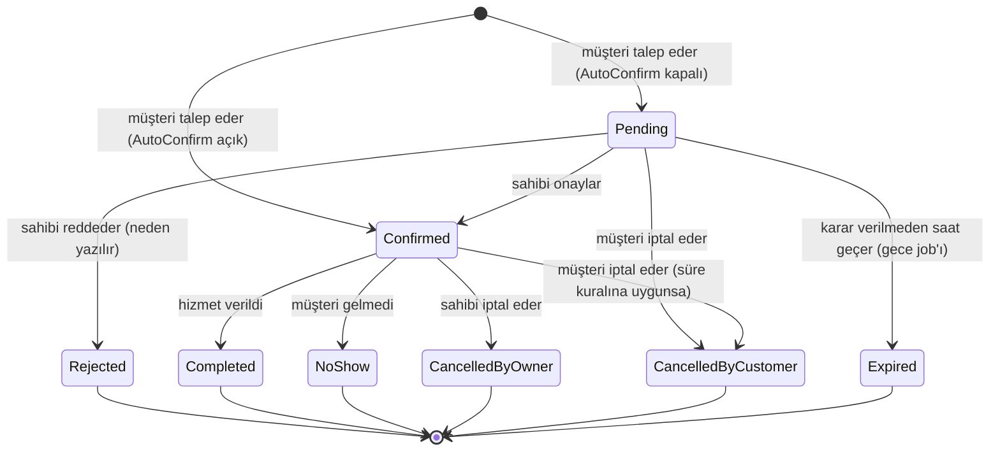

# Appointment State Machine

## Diyagram

## Durumlar

| Durum | Anlamı | Son durum mu? | Slot boşalır mı? |
|---|---|---|---|
| Pending | Müşteri talep etti, sahibi karar vermedi | Hayır | Hayır (slot tutulur) |
| Confirmed | Randevu kesinleşti | Hayır | Hayır |
| Rejected | Sahibi reddetti | Evet | Evet |
| Completed | Hizmet verildi | Evet | n/a (geçmiş) |
| NoShow | Müşteri gelmedi | Evet | n/a (geçmiş) |
| CancelledByCustomer | Müşteri iptal etti | Evet | Evet |
| CancelledByOwner | Sahibi iptal etti | Evet | Evet |
| Expired | Süre doldu, karar verilmedi | Evet | n/a (geçmiş) |

## Geçerli geçişler

| Mevcut durum | Hedef durum | Tetikleyen | Koşul (Guard) |
|---|---|---|---|
| (yok) | Pending | Müşteri | `AutoConfirm = false` |
| (yok) | Confirmed | Müşteri | `AutoConfirm = true` |
| Pending | Confirmed | Owner | - |
| Pending | Rejected | Owner | Red nedeni zorunlu |
| Pending | CancelledByCustomer | Müşteri | `StartTime - şimdi >= CancellationHours` |
| Pending | Expired | Sistem (job) | `StartTime < şimdi` |
| Confirmed | Completed | Owner / sistem | `EndTime < şimdi` |
| Confirmed | NoShow | Owner | `StartTime < şimdi` |
| Confirmed | CancelledByOwner | Owner | Her zaman |
| Confirmed | CancelledByCustomer | Müşteri | `StartTime - şimdi >= CancellationHours` |

## Geçersiz geçişler (domain'de engellenir)

| Geçiş | Neden geçersiz? |
|---|---|
| CancelledByCustomer / CancelledByOwner → Confirmed | İptal geri alınamaz. Müşteri yeniden randevu alır, o saat başkasına geçmiş olabilir. |
| Rejected → Confirmed | Reddedilen talep tekrar açılmaz. |
| Completed → herhangi biri | Hizmet verildi, kayıt dondu. Düzeltme gerekirse ayrı bir yetkili akış tasarlanır. |
| NoShow → Completed | Tutarsız geçmiş verisi oluşturur. |
| Pending → Completed / NoShow | Onaylanmamış randevuda hizmet verilemez. |
| Expired → herhangi biri | Süresi geçmiş talep kapandı. |
| Pending → Pending, Confirmed → Confirmed | Aynı duruma geçiş anlamsız. Çift tıklamada hata yerine idempotent davranmak ayrıca değerlendirilir. |